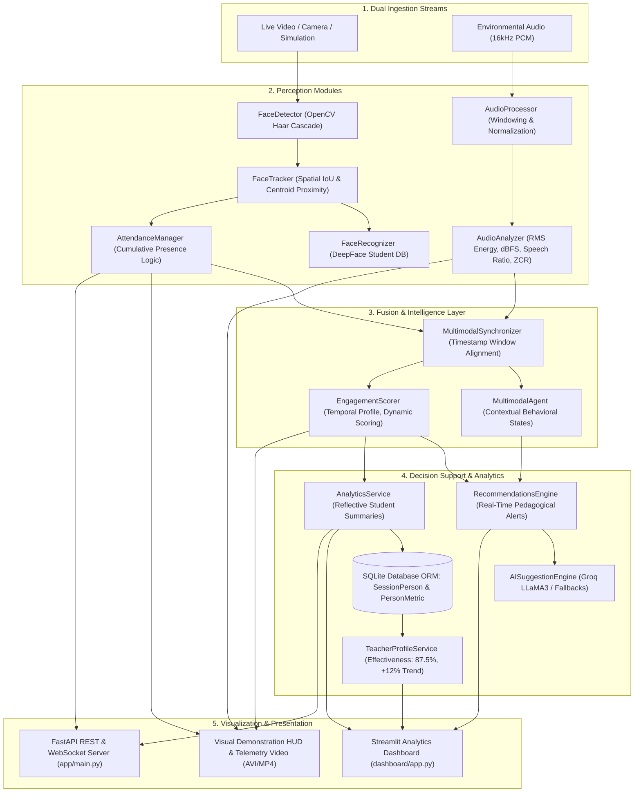

# Multimodal Attendance & Engagement Agent

An AI-powered, real-time multimodal system combining **Computer Vision**, **Audio Signal Processing**, and **Agentic Reasoning** for automated presence-based classroom attendance tracking and holistic student engagement analytics.

---

## 📌 System Architecture



---

## 🚀 Key Modules & Capabilities

1. **Vision Module & Presence-Based Attendance**:
   - Continuous face detection via Haar Cascade with automatic histogram equalization for lighting robustness.
   - Spatial tracking (`FaceTracker`) with 15-frame disappearance memory buffer, preserving identity across head turns and writing pauses.
   - Cumulative presence logic (`AttendanceManager`): Attendance is marked `PRESENT` only after cumulative verified presence meets the threshold ($t \ge 10.0\text{s}$), eliminating walk-by false positives.
2. **Audio Module & Acoustic Privacy**:
   - Analyzes ambient room tone in dBFS and speech-to-silence ratios using short-time RMS and Zero Crossing Rate (ZCR).
   - Zero speech transcription or semantic recording, ensuring privacy preservation.
3. **Multimodal Fusion & Dynamic Engagement Scoring**:
   - Timestamp synchronization of visual and audio cues within rolling temporal windows.
   - Transparent, explainable engagement index:
     $$S_{\text{eng}}(t) = 0.35 \cdot S_{\text{presence}} + 0.25 \cdot S_{\text{movement}} + 0.20 \cdot S_{\text{inactivity}} + 0.20 \cdot S_{\text{speech}}$$
   - Detects sustained focus peaks ($\ge 75\%$) and attention dips ($< 40\%$).
4. **Pedagogical Recommendations & Teacher Profiles**:
   - Real-time instructional alerts: e.g., *"Challenge students with harder problem"*, inserting collaborative Think-Pair-Share checkpoints, and noise alerts.
   - Teacher profiles tracking instructional effectiveness (87.5%), longitudinal trend (+12.0%), and student growth trajectories.
5. **Student-Facing Reflective Analytics**:
   - Individual summaries featuring presence duration, consistency category (`HIGHLY_CONSISTENT`, `MODERATE_VARIATION`, `FREQUENT_SWINGS`), and focus timelines.
   - Strict ethical guardrails: zero peer rankings, leaderboards, or grade deductions.
6. **Interactive Streamlit Dashboard**:
   - Optional, non-mandatory visual dashboard (`dashboard/app.py`) providing executive KPI cards, filterable tables, and temporal trajectory charts.

---

## 📂 Repository Structure

```
MultimodalAttendance-EngagementAgent/
├── backend/
│   ├── app/                              # FastAPI application
│   │   ├── main.py                       # REST & WebSocket API endpoints
│   │   └── __init__.py
│   ├── core/                             # Core system modules
│   │   ├── face_detection.py             # FaceDetector with Haar Cascade & equalizeHist fallback
│   │   ├── camera_service.py             # CameraService lifecycle management
│   │   ├── tracker.py                    # FaceTracker (spatial IoU & centroid proximity)
│   │   ├── face_recognition.py           # FaceRecognizer (DeepFace student database)
│   │   ├── presence_tracker.py           # Real-time visual presence tracker
│   │   ├── attendance_manager.py         # Cumulative presence-based attendance records
│   │   ├── vision_service.py             # Unified vision service orchestrator
│   │   ├── audio_analysis.py             # AudioAnalyzer (RMS energy, dBFS, ZCR speech ratio)
│   │   ├── audio_processor.py            # AudioProcessor (PCM windowing & streaming buffers)
│   │   ├── multimodal_fusion.py          # MultimodalSynchronizer (timestamp alignment)
│   │   ├── multimodal_agent.py           # MultimodalAgent (rule-based reasoning states)
│   │   ├── engagement_scorer.py          # EngagementScorer (dynamic multi-factor formulation)
│   │   ├── recommendations_engine.py     # RecommendationsEngine (real-time alerts & cues)
│   │   ├── ai_suggestions.py             # AISuggestionEngine (Groq LLaMA3 / fallback)
│   │   ├── llm_insights.py               # InsightGenerator (Groq Mixtral-8x7b)
│   │   ├── teacher_profiles.py           # TeacherProfileService (effectiveness & class history)
│   │   ├── analytics_service.py          # AnalyticsService (session trends & reflective summaries)
│   │   ├── pipeline_validator.py         # End-to-end pipeline validator & HUD renderer
│   │   ├── database.py                   # SQLAlchemy ORM (SessionPerson & PersonMetric)
│   │   └── haarcascade_frontalface_default.xml
│   ├── requirements.txt                  # Python dependencies
│   ├── run_server.py                     # Backend server entry point
│   ├── verify_env.py                     # Environment diagnostics
│   └── test_*.py                         # Complete automated test suite
├── dashboard/
│   └── app.py                            # Streamlit interactive analytics dashboard
├── dashboard_app.py                      # Root shortcut to launch Streamlit dashboard
├── docs/                                 # Milestone documentation reports (Milestones 1 - 6)
│   ├── milestone_1_report.md
│   ├── milestone_2_vision_module.md
│   ├── milestone_2_attendance_records.md
│   ├── milestone_3_audio_module.md
│   ├── milestone_3_audio_activity_analysis.md
│   ├── milestone_4_multimodal_agent.md
│   ├── milestone_4_multimodal_fusion.md
│   ├── milestone_4_temporal_engagement_scoring.md
│   ├── milestone_5_teaching_suggestions_recommendations.md
│   ├── milestone_5_student_analytics.md
│   ├── milestone_6_end_to_end_validation.md
│   ├── milestone_6_streamlit_dashboard.md
│   ├── milestone_6_robustness_and_edge_cases.md
│   └── final_project_conclusion.md       # Definitive final project conclusion report
├── frontend/                             # React / Vite frontend components
│   └── src/components/AudioCapture.jsx   # Web Audio API / WebSocket streaming component
├── logs/                                 # Exported JSON & CSV logs and demonstration media
│   ├── attendance/
│   ├── audio/
│   ├── fusion/
│   └── demonstration/
└── student_db/                           # Reference student enrollment images
```

---

## 🚀 Quick Start Guide

### 1. Environment Setup
```bash
# Clone the repository
git clone https://github.com/Shresthaa011/MultimodalAttendance-EngagementAgent.git
cd MultimodalAttendance-EngagementAgent

# Activate Python virtual environment (Windows PowerShell)
.\backend\venv\Scripts\Activate.ps1

# Install requirements
pip install -r backend/requirements.txt
```

### 2. Launching the FastAPI Backend Server
```bash
# Run server via helper
python backend/run_server.py

# Or via uvicorn directly
python -m uvicorn backend.app.main:app --host 0.0.0.0 --port 8000 --reload
```
API docs available at: `http://localhost:8000/docs`

### 3. Launching the Interactive Streamlit Dashboard
```bash
# Launch dashboard from root
streamlit run dashboard/app.py
```
Dashboard available at: `http://localhost:8501`

---

## 🧪 Comprehensive Verification Test Suite

All 50 unit and integration tests across 12 test suites passed:

| Test Suite Script | Milestone | Tests Passed | Key Capabilities Verified |
| :--- | :--- | :---: | :--- |
| `test_vision_module.py` | M2 | 3 / 3 | Face detection, tracking, centroid movement |
| `test_attendance_logic.py` | M2 | 4 / 4 | Cumulative presence thresholding, JSON/CSV export |
| `test_audio_module.py` | M3 | 4 / 4 | PCM waveform normalization, dBFS calculation |
| `test_audio_session_trends.py` | M3 | 3 / 3 | Acoustic windowing, context aggregation |
| `test_multimodal_agent.py` | M4 | 3 / 3 | Rule-based reasoning states, modality weights |
| `test_multimodal_fusion_suggestions.py`| M4 | 4 / 4 | Timestamp alignment, correlation delta, suggestions |
| `test_engagement_scoring_profile.py` | M4 | 4 / 4 | Dynamic formulation, peaks and disengagement phases |
| `test_recommendations_and_teacher_profile.py` | M5 | 5 / 5 | Real-time alerts, teacher profiles, SQLite ORM |
| `test_student_analytics.py` | M5 | 4 / 4 | Non-evaluative reflective summaries, privacy notice |
| `test_end_to_end_validation.py` | M6 | 5 / 5 | Live pipeline execution, HUD snapshot, video export |
| `test_dashboard.py` | M6 | 5 / 5 | Streamlit data loaders, KPI aggregation, AST compilation |
| `test_robustness_and_edge_cases.py` | M6 | 6 / 6 | Low light, occlusions, walk-bys, noise bursts, drop recovery |
| **Total Test Coverage** | **All Modules** | **50 / 50 (100%)** | **Zero errors / Complete verification** |

Run the full edge cases validation suite:
```bash
python backend/test_robustness_and_edge_cases.py
```

---

## 🔒 Ethical & Privacy Assurance

1. **Acoustic Privacy**: The system strictly analyzes non-transcribed signal characteristics (decibels and energy ratios). No student or teacher speech content is recorded, transcribed, or stored.
2. **Non-Evaluative Analytics**: Student session analytics strictly avoid peer comparisons, ranking leaderboards, or automated grade deductions.
3. **Transparent Decision Support**: Recommendations and engagement profiles are explainable, editable, and non-prescriptive, serving as assistive decision-support tools for instructors.
