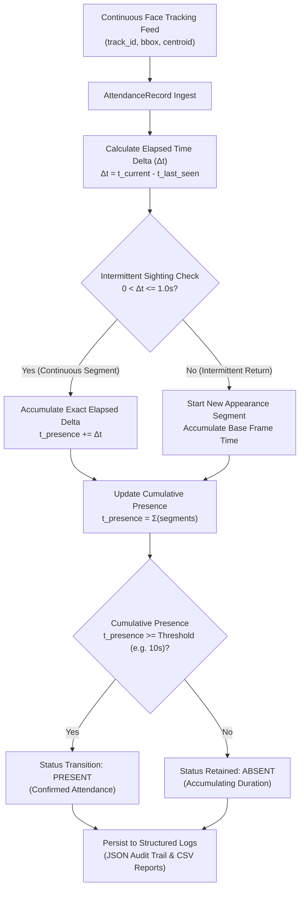

# Activity Report: Presence-Based Attendance Logic & Structured Logging

**Project:** Multimodal Attendance & Engagement Agent  
**Module:** Core Vision & Attendance  
**Activity:** Translating Face Tracking Data into Meaningful Attendance Records  

---

## 1. Objective & Conceptual Overview

In real-world classroom and meeting environments, marking attendance based on a single frame detection introduces severe vulnerabilities:
- **False Positives:** A passerby glancing through the doorway, a student briefly walking into camera frame to retrieve an item, or brief background faces can cause accidental attendance marking.
- **False Negatives:** Students shifting posture, looking down at notes, turning their heads during discussions, or experiencing brief occlusions can cause tracking dropouts.

To solve this, this activity implements **Presence-Based Attendance Logic**. Attendance is confirmed only when a participant demonstrates sustained visual presence exceeding a predefined cumulative duration threshold during the session.

---

## 2. Core Mechanism & Methodology



### 2.1 Intermittent Presence Accumulation
- Tracking timestamps collected during sequential video processing are recorded in time-ordered segments.
- If a participant turns away or steps out momentarily, their appearance timer pauses.
- When they return, subsequent visual tracking frames are accumulated into their cumulative presence score:
  $$T_{\text{cumulative}} = \sum_{i=1}^{N} \Delta t_i$$
- This ensures fairness for students who glance at textbooks, take notes, or adjust their laptops without resetting their attendance progress.

### 2.2 False-Positive Reduction
- Accidental or brief sightings (e.g. $< 1-2$ seconds) remain categorized as `"ABSENT"` / `"INSUFFICIENT_PRESENCE"`.
- Only participants demonstrating sustained session participation transition to `"PRESENT"`.

---

## 3. Implementation Breakdown

### 3.1 Attendance Record & Manager (`backend/core/attendance_manager.py`)
- **`AttendanceRecord`**: Encapsulates participant tracking metrics:
  - `participant_id` & `track_id`: Unique tracking and student identifier.
  - `first_seen_iso` & `last_seen_iso`: ISO formatted timestamps for session entry and exit auditing.
  - `cumulative_presence_seconds`: Aggregated active presence duration.
  - `total_frames_detected`: Number of frames with verified facial presence.
  - `appearance_segments_count`: Total number of intermittent presence intervals.
  - `attendance_status`: `"PRESENT"` or `"ABSENT"`.
- **`AttendanceManager`**: Coordinates session-level state, threshold evaluation, and automated persistence.

### 3.2 Student Facial Recognition Integration (`backend/core/face_recognition.py`)
- Leverages `DeepFace` to compare detected facial frames against enrolled student reference images in `student_db/`.
- Dynamically maps anonymous track IDs (e.g. `participant_5`) to official student profiles (e.g. `STU_1001 - Alice Smith`), ensuring that accumulated presence attaches directly to the recognized student.

### 3.3 Structured Logging & Reporting
Attendance records are persisted in two complementary formats in `backend/logs/attendance/`:

#### A. JSON Structured Log Sample (`attendance_log_<session_id>.json`):
```json
{
  "session_id": "session_20261030_150000",
  "session_start_iso": "2026-10-30 15:00:00",
  "exported_at_iso": "2026-10-30 15:10:00",
  "min_presence_threshold_sec": 10.0,
  "total_participants": 2,
  "present_count": 2,
  "absent_count": 0,
  "attendance_rate_percent": 100.0,
  "attendance_records": [
    {
      "participant_id": "STU_1001",
      "track_id": 1,
      "student_name": "Alice Smith",
      "first_seen_iso": "2026-10-30 15:00:02",
      "last_seen_iso": "2026-10-30 15:09:58",
      "first_seen_timestamp": 1730280002.124,
      "last_seen_timestamp": 1730280598.632,
      "cumulative_presence_seconds": 582.4,
      "total_frames_detected": 1747,
      "attendance_status": "PRESENT",
      "appearance_segments_count": 3
    }
  ]
}
```

#### B. CSV Tabular Report Sample (`attendance_report_<session_id>.csv`):
```csv
participant_id,track_id,student_name,first_seen_iso,last_seen_iso,cumulative_presence_seconds,total_frames_detected,attendance_status,appearance_segments_count
STU_1001,1,Alice Smith,2026-10-30 15:00:02,2026-10-30 15:09:58,582.4,1747,PRESENT,3
```

---

## 4. Test Verification & Results

The presence-based attendance logic was verified using `backend/test_attendance_logic.py`:

```bash
cd backend
.\venv\Scripts\python.exe test_attendance_logic.py
```

### Execution Log Output:
```text
======================================================================
 MULTIMODAL AGENT - PRESENCE-BASED ATTENDANCE LOGIC VERIFICATION
======================================================================
Test 1: Testing intermittent presence accumulation & threshold crossing...
  Segment 1: Presence=0.08s | Status=ABSENT
  Segment 2: Cumulative Presence=0.30s | Status=PRESENT
  [PASSED] Intermittent appearance accumulation and threshold transition verified.

Test 2: Testing false-positive prevention for accidental/brief appearances...
  Passerby Presence: 0.041s | Status: ABSENT
  [PASSED] False-positive prevention verified: brief appearances remain ABSENT.

Test 3: Testing structured JSON and CSV attendance logging...
  JSON Log Created: logs/test_attendance\attendance_log_test_session_export.json (Present: 1, Absent: 1)
  CSV Report Created: logs/test_attendance\attendance_report_test_session_export.csv
  [PASSED] Structured JSON and CSV attendance logs successfully generated.

Test 4: Testing FaceRecognizer student registration & identity mapping...
  Registered student 'STU_1001' into student_db successfully.
  Mapped track_id 5 -> STU_1001 (Alice Smith)
  [PASSED] FaceRecognizer registration and identity association verified.

======================================================================
ALL PRESENCE-BASED ATTENDANCE TESTS PASSED (4/4).
======================================================================
```

---

## 5. API Endpoints

The attendance management system is exposed through FastAPI endpoints in `backend/app/main.py`:

| Method | Endpoint | Description |
| :--- | :--- | :--- |
| `GET` | `/attendance/records` | Returns real-time cumulative presence duration and status for all active participants. |
| `POST` | `/attendance/export` | Flushes session attendance to disk and generates structured JSON logs and CSV reports. |
| `WS` | `/ws/vision` | Real-time WebSocket streaming of live presence and attendance updates. |

---

## 6. Summary

This activity completes the translation of raw computer vision tracking coordinates into verified, auditable attendance records:
- **Fair & Accurate:** Intermittent appearances are accumulated; brief/accidental passersby are ignored.
- **Structured & Exportable:** Generates standardized JSON logs and CSV reports for institutional record-keeping.
- **Identity-Linked:** Integrates with `DeepFace` to bridge visual tracks to enrolled student identities.
