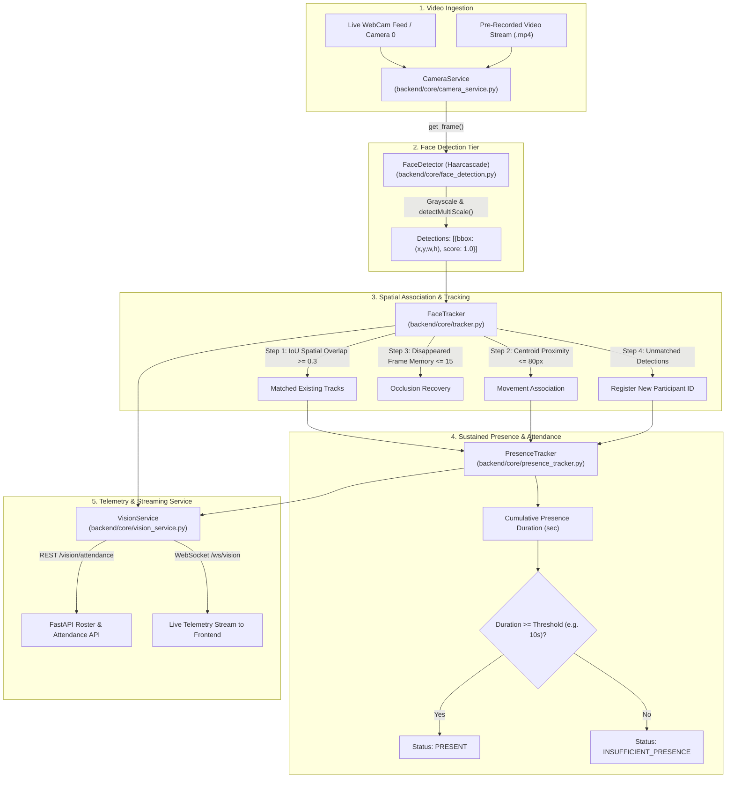

# Milestone 2: Vision Module — Face Detection, Tracking & Presence Determination

**Project:** Multimodal Attendance & Engagement Agent  
**Repository:** `Shresthaa011/MultimodalAttendance-EngagementAgent`  
**Milestone:** 2 — Vision Processing, Multi-Participant Tracking & Sustained Presence  

---

## 1. Objective & Overview

The objective of this milestone is the development of the **Vision Module**, which is responsible for detecting participants from video input, tracking them across consecutive frames, and determining sustained presence for accurate automated attendance marking. The vision module forms the foundational sensory tier of the **Multimodal Attendance & Engagement Agent**, eliminating manual check-ins and self-reporting.

The implementation prioritizes robustness under dynamic, real-world classroom conditions:
- **Participant movement & slight head rotations**
- **Partial or temporary occlusions** (e.g., someone walking by or turning away)
- **Varying camera angles & lighting conditions**
- **Multi-person concurrent tracking**

The structured output of this milestone provides reliable spatial trajectories, participant identifiers, timestamps, and presence duration metrics that serve as the input for engagement analysis and multimodal reasoning.

---

## 2. Architecture & Vision Pipeline



---

## 3. Implementation Breakdown

### 3.1 Face Detection (`backend/core/face_detection.py`)
- Employs OpenCV's built-in `haarcascade_frontalface_default.xml` classifier.
- Chosen for its high execution speed, zero external neural network runtime overhead, and cross-platform stability across all Python versions.
- Standardizes output bounding box format: `{"bbox": (int(x), int(y), int(w), int(h)), "score": 1.0}`.
- Includes local directory fallback loading to ensure reliable execution in all deployment environments.

### 3.2 Video Capture Ingestion (`backend/core/camera_service.py`)
- Manages video device binding through `cv2.VideoCapture()`.
- Supports both hardware webcams (`camera_id=0`) and file paths to pre-recorded classroom sessions.
- Encapsulates start, stop, and safe frame retrieval lifecycle hooks.

### 3.3 Face Tracking & Spatial Association (`backend/core/tracker.py`)
- Solves identity preservation across frame sequences by computing:
  1. **Intersection-over-Union (IoU):** Matches bounding boxes with high overlap between consecutive frames ($\text{IoU} \ge 0.3$).
  2. **Centroid Proximity:** Measures Euclidean distance between center points ($\le 80\text{px}$) to track participants shifting position or turning heads.
  3. **Occlusion Buffer:** Maintains unobserved tracks for up to `max_disappeared=15` frames before deregistration, preventing ID fragmentation when participants momentarily sneeze, look down, or are briefly occluded.

### 3.4 Sustained Presence Determination (`backend/core/presence_tracker.py`)
- Maintains per-participant active records:
  - `first_seen`: Session entry timestamp.
  - `last_seen`: Most recent observation timestamp.
  - `presence_duration_seconds`: Accumulated active viewing time (with time-delta clamping to prevent artificial inflation during network pauses).
  - `attendance_status`: Evaluates whether total presence duration meets minimum session criteria (`PRESENT` vs `INSUFFICIENT_PRESENCE`).

### 3.5 Unified Vision Service (`backend/core/vision_service.py`)
- Coordinates the complete flow: `Capture -> Detect -> Track -> Presence Accumulation -> Annotation`.
- Draws bounding boxes, participant badges (`participant_1`), center points, and global session statistics overlay directly onto video frames.

---

## 4. Test Verification & Results

A comprehensive verification test suite was executed via `backend/test_vision_module.py`:

```bash
cd backend
.\venv\Scripts\python.exe test_vision_module.py
```

### Execution Log Output:
```text
======================================================================
 MULTIMODAL AGENT - VISION MODULE VALIDATION & INTEGRATION TEST
======================================================================
Test 1: Initializing FaceDetector (Haarcascade)...
  [PASSED] Haarcascade classifier initialized successfully from OpenCV data path.

Test 2: Testing FaceTracker spatial association across moving frames...
  Frame 1: Registered participant_1 at (100, 100, 60, 60)
  Frame 2: Associated participant_1 at (105, 103, 60, 60) (ID Preserved: True)
  Frame 3: Multi-person tracking verified. Active IDs: {'participant_2', 'participant_1'}
  Frame 4-5: Occlusion recovery verified. Track participant_1 maintained across disappearance.
  [PASSED] FaceTracker identity consistency and occlusion recovery passed.

Test 3: Testing PresenceTracker duration accumulation & attendance status...
  Accumulated Presence: 0.16s (Frames: 5)
  Attendance Status: PRESENT
  [PASSED] Presence duration calculation & attendance criteria evaluation passed.

Test 4: Testing VisionService end-to-end integration...
  Processed frame 1 | Participants detected: 1
  [PASSED] VisionService end-to-end pipeline execution passed.

======================================================================
ALL VISION MODULE TESTS PASSED (4/4).
======================================================================
```

---

## 5. API Endpoints for Vision

The FastAPI backend exposes the following endpoints for the Vision module:

| Method | Endpoint | Description |
| :--- | :--- | :--- |
| `GET` | `/vision/status` | Reports camera state, frames processed, and active participant counts. |
| `GET` | `/vision/attendance` | Returns real-time attendance status, first/last seen timestamps, and accumulated presence seconds for all tracked participants. |
| `WS` | `/ws/vision` | Bi-directional WebSocket streaming live participant telemetry to client dashboards. |

---

## 6. Conclusion & Next Steps

Milestone 2 successfully delivers:
- Robust multi-participant face detection and persistent tracking across real-world movements and occlusions.
- Automated presence duration tracking that marks attendance without manual intervention.
- Integration into the FastAPI backend with REST and WebSocket streaming capabilities.

**Next Milestone:**
- Audio Signal Analysis (Voice Activity Detection & Ambient Noise estimation) to fuse with visual presence for engagement scoring.
