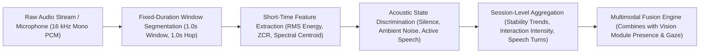

# Milestone 3 — Audio Module Activity Documentation
## Activity: Ambient Noise Level Analysis, Speech Activity Patterns & Multimodal Context Fusion

---

### 1. Executive Summary & Objective

This activity advances the **Audio Module** of the **Multimodal Attendance & Engagement Agent** by analyzing normalized acoustic signals to quantify **ambient noise levels**, characterize **speech activity patterns**, and aggregate **session-level dynamics**. 

Rather than executing speech-to-text recognition or processing linguistic content—which poses severe privacy risks and high computational overhead—the module operates exclusively on **low-level physical acoustic features** (RMS energy, amplitude variation, decibel level, zero-crossing rate, and spectral centroid). These acoustic cues provide indirect yet accurate signals of classroom environment conditions, teacher-student interaction intensity, and peer discussion bursts, which are structured into a standardized schema for downstream multimodal reasoning with the Vision Module.



---

### 2. Acoustic Feature Computation & Mathematical Formulations

The audio processor segments digital waveforms into non-overlapping or hopping temporal windows ($W_t$ of duration $T_w = 1.0\text{ s}$ at $f_s = 16{,}000\text{ Hz}$). Each window is sub-divided into short analysis frames of length $N = 512$ with a hop length $H = 256$ to compute the following acoustic indicators:

#### 2.1 Root Mean Square (RMS) Energy & Decibel Level (dBFS)
The physical loudness and energy of the audio chunk is evaluated via frame-level RMS:
$$\text{RMS}_m = \sqrt{\frac{1}{N} \sum_{n=0}^{N-1} x_m[n]^2}$$
The mean RMS across all frames in the window is converted to decibels relative to full scale (dBFS), bounded by a noise floor of $-100.0\text{ dBFS}$:
$$\text{Noise Level (dB)} = 20 \cdot \log_{10}\left(\max\left(\overline{\text{RMS}}, 10^{-5}\right)\right)$$

#### 2.2 Zero Crossing Rate (ZCR)
Zero crossing rate quantifies the frequency of sign changes in the digital signal, differentiating unvoiced phonemes and fricatives from low-frequency background hums:
$$\text{ZCR}_m = \frac{1}{2N} \sum_{n=1}^{N-1} \left| \text{sgn}(x_m[n]) - \text{sgn}(x_m[n-1]) \right|$$

#### 2.3 Spectral Centroid
Spectral centroid indicates the "brightness" or center of mass of the frequency spectrum:
$$\text{Centroid}_m = \frac{\sum_{k=0}^{K-1} f_k \cdot |X_m[k]|}{\sum_{k=0}^{K-1} |X_m[k]|}$$
Human vocal fold vibrations and speech formants typically occupy the frequency band between $200\text{ Hz}$ and $3500\text{ Hz}$, distinguishing speech signals from mechanical rumbling ($<150\text{ Hz}$) or high-frequency hiss ($>5000\text{ Hz}$).

#### 2.4 Speech vs. Silence Ratio
Within each $1.0\text{ s}$ window, sub-frames with energy above the speech detection threshold ($\text{RMS} \ge 0.015$) are classified as speech frames:
$$\text{Speech Ratio} = \frac{\sum_{m=1}^{M} \mathbb{I}\left(\text{RMS}_m \ge 0.015 \land 200 \le \text{Centroid}_m \le 3500\right)}{M}$$

---

### 3. Acoustic State Discrimination

Based on computed acoustic features, each temporal segment is categorized into one of four distinct classroom behavioral states:

| Behavioral State | Criteria / Acoustic Profile | Classroom Dynamic Meaning |
| :--- | :--- | :--- |
| **`quiet_listening`** | Noise $< -45.0\text{ dB}$, Speech Ratio $< 0.10$ | Attentive lecture mode, individual exam, or silent study |
| **`active_discussion`** | Noise $\ge -35.0\text{ dB}$, Speech Ratio $\ge 0.25$ | Student answering questions, peer debate, or active group discussion |
| **`intermittent_speech`** | Noise $\ge -42.0\text{ dB}$, Speech Ratio $\in [0.10, 0.25)$ | Brief verbal acknowledgment, single prompt, or turn transition |
| **`high_ambient_disturbance`** | Noise $\ge -28.0\text{ dB}$, Speech Ratio $< 0.10$ | Door slam, hallway chatter, desk rustling, or audio feedback |

---

### 4. Session-Level Context Aggregation

Real-world classroom dynamics cannot be inferred from a single isolated window. The system maintains an aggregate rolling context across previous windows ($k = 10\dots 60$), deriving high-level session indicators:

1. **Noise Level Stability:**
   - **`steady`** ($\sigma_{\text{dB}} < 3.0\text{ dB}$): Consistent acoustic environment without sudden acoustic spikes.
   - **`moderate_fluctuation`** ($3.0 \le \sigma_{\text{dB}} < 7.0\text{ dB}$): Natural variations in classroom volume.
   - **`erratic_disturbance`** ($\sigma_{\text{dB}} \ge 7.0\text{ dB}$): Unstable or chaotic ambient noise patterns.

2. **Speech Interaction Intensity:**
   - Evaluated from the rolling average speech ratio $\overline{S_r}$:
     - $\overline{S_r} \ge 0.40 \implies$ **`high_interaction`**
     - $0.15 \le \overline{S_r} < 0.40 \implies$ **`moderate_participation`**
     - $\overline{S_r} < 0.15$ with isolated speech bursts $\implies$ **`low_intermittent`**
     - No speech detected $\implies$ **`silent_listening`**

3. **Speech Turn Count / Participation Frequency:**
   - Detects transitions from non-speech to active speech states across sequential windows, quantifying interaction turns during the session.

---

### 5. Multimodal Fusion Ready Schema

To combine visual presence and gaze engagement with acoustic participation, the backend exports a standardized JSON structure accessible via `GET /audio/context` and emitted in real time over `ws://localhost:8000/ws/audio`:

```json
{
  "timestamp": 1793366950.123,
  "windows_analyzed": 120,
  "noise_metrics": {
    "current_noise_level_db": -24.8,
    "mean_noise_level_db": -28.4,
    "noise_std_dev": 2.1,
    "noise_stability": "steady"
  },
  "speech_dynamics": {
    "speech_detected": true,
    "recent_speech_ratio": 0.45,
    "interaction_intensity": "high_interaction",
    "speech_bursts_count": 8
  },
  "multimodal_fusion_cues": {
    "acoustic_engagement_score": 0.88,
    "classroom_activity_state": "active_discussion"
  }
}
```

#### Multimodal Fusion Synergy:
- **Visual PRESENT + Acoustic `active_discussion`**: High engagement, active collaboration.
- **Visual PRESENT + Acoustic `quiet_listening`**: Attentive lecture listening, individual work.
- **Visual ABSENT + Acoustic `active_discussion`**: Off-screen verbal participation or external speaker.
- **Visual PRESENT + Acoustic `high_ambient_disturbance`**: Environmental disruption, low focus probability.

---

### 6. Full-Stack Integration Architecture

#### 6.1 Frontend Real-Time Streaming (`AudioCapture.jsx`)
The React component `AudioCapture.jsx` captures raw microphone input using the browser Web Audio API:
- Requests microphone permission via `navigator.mediaDevices.getUserMedia({ audio: true })`.
- Initializes an `AudioContext` forced to $16{,}000\text{ Hz}$ mono.
- Employs a `ScriptProcessorNode` / `AudioWorkletNode` with a buffer size of 4096 samples.
- Converts `Float32Array` browser samples into signed 16-bit PCM bytes (`Int16Array`).
- Streams raw binary buffers continuously over WebSocket connection `ws://localhost:8000/ws/audio`.
- Handles connection lifecycle, auto-cleanup on unmount, and delivers telemetry payloads back to parent views via the `onMetrics` callback.

#### 6.2 Backend WebSocket & REST Endpoints (`main.py`)
- `GET /audio/status`: Provides pipeline health, buffer occupancy, and total windows processed.
- `POST /audio/analyze-chunk`: Evaluates single audio payloads (raw Base64 PCM or float array).
- `GET /audio/context`: Delivers session-level aggregated telemetry for fusion.
- `POST /audio/export`: Generates structured JSON and CSV reports in `logs/audio/`.
- `WS /ws/audio`: Full-duplex real-time streaming endpoint consuming binary 16-bit PCM and responding with instantaneous window metrics and session context.

---

### 7. Verification & Test Results

The audio analysis implementation was validated using comprehensive automated unit and integration tests:

```text
======================================================================
 MULTIMODAL AGENT - AUDIO ACTIVITY & NOISE ANALYSIS TEST SUITE
======================================================================
Test 1: Testing short-time feature computation & state discrimination...
  Quiet State: Noise=-66.07 dB | Pattern=quiet_listening
  Speech State: Noise=-15.44 dB | Speech Ratio=0.905 | Pattern=active_discussion
  Ambient Noise State: Noise=-26.05 dB | Pattern=intermittent_speech
  [PASSED] Feature computation & acoustic state discrimination verified.

Test 2: Testing session-level aggregation & multimodal fusion cues...
  Session Windows Analyzed: 6
  Noise Level Dynamics: Mean=-39.1 dB | Stability=erratic_disturbance
  Speech Interaction: Intensity=moderate_participation | Turns=1
  Multimodal Fusion Cue: Score=0.623 | State=normal_ambient_noise
  [PASSED] Session-level acoustic aggregation and fusion cues verified.

Test 3: Testing FastAPI WebSocket (/ws/audio) real-time streaming...
  WebSocket Telemetry -> Noise: -11.03 dB | Speech: True | Engagement: 1.0
  Session Context -> Intensity: high_interaction
  [PASSED] WebSocket real-time audio ingest and telemetry streaming verified.

======================================================================
ALL AUDIO ACTIVITY TESTS PASSED (3/3).
======================================================================
```

Alongside the core audio pipeline test:
```text
======================================================================
ALL AUDIO MODULE TESTS PASSED (5/5).
======================================================================
```

---

### 8. Architectural File Reference

- [`backend/core/audio_analysis.py`](file:///e:/Multimodal%20Attendance%20%26%20Engagement%20Agent/MultimodalAttendance-EngagementAgent/backend/core/audio_analysis.py): Feature extraction (RMS, dBFS, ZCR, spectral centroid, speech ratio) and acoustic state classification.
- [`backend/core/audio_processor.py`](file:///e:/Multimodal%20Attendance%20%26%20Engagement%20Agent/MultimodalAttendance-EngagementAgent/backend/core/audio_processor.py): Sampling rate normalization, window segmentation, streaming buffer management, and session context aggregation.
- [`backend/app/main.py`](file:///e:/Multimodal%20Attendance%20%26%20Engagement%20Agent/MultimodalAttendance-EngagementAgent/backend/app/main.py): FastAPI backend providing `/audio/*` endpoints and `/ws/audio` WebSocket server.
- [`frontend/src/components/AudioCapture.jsx`](file:///e:/Multimodal%20Attendance%20%26%20Engagement%20Agent/MultimodalAttendance-EngagementAgent/frontend/src/components/AudioCapture.jsx): React component capturing 16 kHz mono microphone audio and streaming over WebSocket.
- [`backend/test_audio_session_trends.py`](file:///e:/Multimodal%20Attendance%20%26%20Engagement%20Agent/MultimodalAttendance-EngagementAgent/backend/test_audio_session_trends.py): Automated test suite for short-time feature computation, session trends, and WebSocket telemetry streaming.

