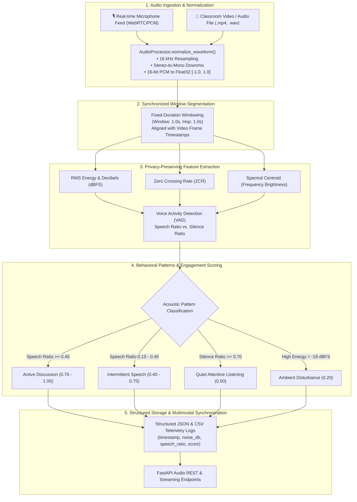

# Milestone 3: Audio Module — Signal Preprocessing, Noise Profiling & Privacy-Preserving Activity Detection

**Project:** Multimodal Attendance & Engagement Agent  
**Repository:** `Shresthaa011/MultimodalAttendance-EngagementAgent`  
**Milestone:** 3 — Environmental Audio Analysis & Privacy-Preserving Acoustic Cues  

---

## 1. Objective & Conceptual Overview

While computer vision captures visual presence and physical attentiveness, classroom dynamics are inherently multimodal. Environmental sound provides direct, contextual indications of interaction, lecture pacing, student participation, and ambient distractions.

The **Audio Module** complements the Vision Module by analyzing environmental audio to quantify:
- **Ambient Noise Floor & Decibel Levels ($dBFS$)**
- **Speech vs. Silence Ratio (Voice Activity Detection)**
- **Acoustic Interaction Patterns** (Active Discussion vs. Quiet Attentive Listening vs. Disturbance)
- **Acoustic Engagement Scoring**

### Privacy Preservation by Design
A fundamental architectural requirement is that **no speech recognition (ASR) or content transcription is performed**. Conversations are never parsed into text, guaranteeing participant privacy while extracting behavioral cues purely through acoustic signal features.

---

## 2. Audio Processing Architecture & Data Flow



---

## 3. Implementation Details

### 3.1 Acoustic Feature Analyzer (`backend/core/audio_analysis.py`)
- **Root Mean Square (RMS) & Decibels ($dBFS$):**
  $$\text{RMS} = \sqrt{\frac{1}{N} \sum_{n=0}^{N-1} y[n]^2}, \quad \text{dBFS} = 20 \log_{10}(\max(\text{RMS}, 10^{-5}))$$
- **Zero Crossing Rate (ZCR):** Quantifies rate of sign changes along the waveform to detect voiced vs. unvoiced consonants and ambient noise.
- **Spectral Centroid:** Measures the "center of mass" of sound frequencies to distinguish speech frequency bands ($300\text{ Hz} - 3800\text{ Hz}$) from low-frequency hums.
- **Voice Activity Detection (VAD):** Combines frame energy, ZCR articulatory boundaries ($0.015 \le \text{ZCR} \le 0.35$), and spectral centroid thresholds ($250\text{ Hz} \le f_c \le 4000\text{ Hz}$) to quantify the exact ratio of vocal activity without natural language processing.

### 3.2 Ingestion, Normalization & Windowing (`backend/core/audio_processor.py`)
- **Sampling Rate Normalization:** Automatically resamples disparate input streams (e.g. 44.1 kHz or 48 kHz) to standard **16,000 Hz**.
- **Channel Standardization:** Multi-channel and stereo recordings are converted to mono by spatial averaging ($y_{\text{mono}} = \frac{1}{C}\sum y_c$).
- **Fixed-Duration Window Segmentation:** Continuous waveforms are segmented into fixed 1.0-second analysis windows with relative and absolute timestamps ($t_{\text{start}}, t_{\text{end}}$), allowing synchronization with corresponding video frames.
- **Streaming Buffer:** Maintained internal FIFO buffer to slice live incoming audio packets from WebSockets without dropping boundaries.

---

## 4. Structured Output Format

Processed audio metrics are persisted in structured JSON and CSV formats under `backend/logs/audio/`:

### A. JSON Structured Telemetry Sample (`audio_session_<id>.json`):
```json
{
  "session_id": "session_20261030_185000",
  "sample_rate_hz": 16000,
  "window_duration_sec": 1.0,
  "total_windows_processed": 300,
  "average_noise_level_db": -32.4,
  "overall_speech_ratio": 0.42,
  "dominant_activity_pattern": "active_discussion",
  "windows": [
    {
      "window_index": 0,
      "relative_start_sec": 0.0,
      "relative_end_sec": 1.0,
      "absolute_start_timestamp": 1730294400.0,
      "absolute_end_timestamp": 1730294401.0,
      "rms_energy": 0.04215,
      "noise_level_db": -27.5,
      "speech_detected": true,
      "speech_ratio": 0.625,
      "silence_ratio": 0.125,
      "zero_crossing_rate": 0.0824,
      "spectral_centroid": 1420.5,
      "activity_pattern": "active_discussion",
      "acoustic_engagement_score": 0.888
    }
  ]
}
```

### B. CSV Tabular Export Sample:
```csv
window_index,relative_start_sec,relative_end_sec,noise_level_db,speech_detected,speech_ratio,silence_ratio,zero_crossing_rate,spectral_centroid,activity_pattern,acoustic_engagement_score
0,0.0,1.0,-27.5,True,0.625,0.125,0.0824,1420.5,active_discussion,0.888
```

---

## 5. Automated Test Suite & Benchmark Results

The audio pipeline was validated using `backend/test_audio_module.py`:

```bash
cd backend
.\venv\Scripts\Activate.ps1
python test_audio_module.py
```

### Verified Test Log Output:
```text
======================================================================
 MULTIMODAL AGENT - AUDIO MODULE VALIDATION & INTEGRATION TEST
======================================================================
Test 1: Testing silence / quiet classroom analysis...
  Silence Analysis -> Noise: -66.03 dB | Speech: False | Pattern: quiet_listening
  [PASSED] Silence and quiet listening classification verified.

Test 2: Testing speech activity & acoustic engagement cues...
  Speech Analysis -> Noise: -15.02 dB | Speech Ratio: 0.905 | Score: 0.971 | Pattern: active_discussion
  [PASSED] Speech detection and acoustic engagement scoring verified.

Test 3: Testing raw 16-bit PCM bytes ingestion...
  PCM Bytes Ingestion -> Converted 16000 bytes | Noise: -15.11 dB | Speech: True
  [PASSED] Raw 16-bit PCM byte array handling verified.

Test 4: Testing AudioProcessor normalization, windowing & segmentation...
  Normalized Stereo 44.1kHz -> Mono 16kHz (48000 samples)
  Segmented into 3 synchronized 1.0s windows with aligned timestamps.
  [PASSED] Waveform normalization and fixed-window segmentation verified.

Test 5: Testing structured JSON and CSV audio telemetry logging...
  JSON Log Created: logs/test_audio\test_audio_session_01.json (Windows: 2, Avg Noise: -40.6 dB)
  CSV Report Created: logs/test_audio\test_audio_session_01.csv
  [PASSED] Structured JSON and CSV audio logging verified.

======================================================================
ALL AUDIO MODULE TESTS PASSED (5/5).
======================================================================
```

---

## 6. Integrated API Endpoints

The Audio Module is exposed through FastAPI endpoints in `backend/app/main.py`:

| Method | Endpoint | Description |
| :--- | :--- | :--- |
| `GET` | `/audio/status` | Returns pipeline status, sample rate, total windows, and buffered samples. |
| `POST` | `/audio/analyze-chunk` | Ingests PCM bytes or raw audio arrays, returning real-time noise dB, speech ratio, and acoustic engagement. |
| `POST` | `/audio/export` | Flushes processed audio windows to structured JSON logs and CSV reports on disk. |

---

## 7. Conclusion & Next Steps

Milestone 3 successfully establishes:
- Standardized audio waveform normalization (16 kHz mono) and fixed-window segmentation for video timestamp alignment.
- Fast, privacy-preserving acoustic feature extraction and voice activity detection without speech transcription.
- Structured telemetry logging and API endpoints ready for multimodal fusion.

**Upcoming Step (Multimodal Fusion):**
- Correlating visual focus (head pose, gaze, presence) with acoustic dynamics (speech participation, background noise) to compute a unified classroom Engagement Index.

