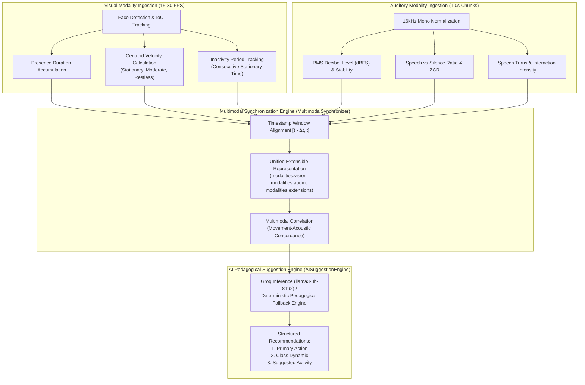

# Milestone 4 — Activity Documentation
## Multimodal Signal Synchronization, Unified Representation & AI Suggestions

---

### 1. Executive Summary & Activity Objective

This activity implements the **multimodal synchronization, unified aggregation, and AI suggestion pipeline** of the **Multimodal Attendance & Engagement Agent**. Visual and auditory signals operate at different temporal resolutions: video frames are processed at high frame rates (15–30 FPS, $\sim 33\text{--}66\text{ ms}$ intervals), whereas audio features are analyzed over windowed chunks ($1.0\text{ s}$ intervals).

Through **timestamp-based temporal synchronization**, visual indicators (cumulative presence duration, centroid velocity, movement patterns, and inactivity timers) are aligned with corresponding acoustic indicators (ambient noise level dBFS, speech activity ratio, interaction intensity, and speech turns). By correlating physical movement with vocal interactions, the system constructs an **extensible, unified multimodal data representation** that powers the `AISuggestionEngine` (`llama3-8b-8192`) to deliver real-time, actionable pedagogical interventions for instructors.



---

### 2. Timestamp-Based Synchronization & Temporal Alignment

Because video and audio frames are acquired asynchronously across independent worker threads or hardware devices, the `MultimodalSynchronizer` manages two synchronized sliding buffers:
- `vision_buffer`: Stores timestamped visual state vectors $V(t) = \langle \text{presence}, \text{velocity}, \text{pattern}, \text{inactivity}, \text{score} \rangle$.
- `audio_buffer`: Stores timestamped acoustic state vectors $A(t) = \langle \text{noise\_db}, \text{speech\_ratio}, \text{intensity}, \text{turns}, \text{pattern} \rangle$.

#### Temporal Alignment Operator
For any synchronization query at target timestamp $t_{\text{sync}}$ with window size $W_{\text{sync}} = 1.0\text{ s}$, the alignment operator filters matching observations:
$$\mathcal{V}_{\text{match}} = \left\{ V(t_v) \mid t_{\text{sync}} - W_{\text{sync}} \le t_v \le t_{\text{sync}} \right\}$$
$$\mathcal{A}_{\text{match}} = \left\{ A(t_a) \mid t_{\text{sync}} - W_{\text{sync}} \le t_a \le t_{\text{sync}} \right\}$$
The latest observations within the matching window are synthesized to yield an instantaneous, unified snapshot.

---

### 3. Visual Movement Patterns & Inactivity Metrics

#### 3.1 Centroid Velocity Tracking
For each tracked participant $p$ with bounding box centroid $\mathbf{c}_k = (x_k + w_k/2, y_k + h_k/2)$ observed at timestamp $t_k$, the instantaneous velocity is calculated against its previous sighting at $t_{k-1}$:
$$v_p(t_k) = \frac{\|\mathbf{c}_k - \mathbf{c}_{k-1}\|_2}{\Delta t_k} \quad (\text{px/sec})$$
The collective visual movement velocity $\bar{v}$ across all active participants is categorized into three pedagogical movement patterns:
- **`stationary`** ($\bar{v} < 2.5\text{ px/sec}$): Concentrated, still posture; typical during reading, writing, or focused listening.
- **`moderate_natural_movement`** ($2.5 \le \bar{v} \le 25.0\text{ px/sec}$): Normal gesturing, shifting posture, or taking notes.
- **`restless_excessive_movement`** ($\bar{v} > 25.0\text{ px/sec}$): Frequent head turning, agitation, or classroom fidgeting.

#### 3.2 Inactivity Period Accumulation
When a participant's velocity remains beneath the motion threshold ($v_p < 3.0\text{ px/sec}$) across consecutive frames, an inactivity timer accumulates:
$$\tau_{\text{inactivity}} = t_{\text{current}} - t_{\text{stationary\_start}}$$
If $\tau_{\text{inactivity}} > 8.0\text{ s}$ while speech is absent, the system flags passive inattention or lecture fatigue.

---

### 4. Proportional Multimodal Correlation Matrix

The fusion engine correlates physical visual movement patterns with acoustic interaction levels into distinct behavioral states:

| Movement-Acoustic State | Visual Indicators | Audio Indicators | Pedagogical Meaning |
| :--- | :--- | :--- | :--- |
| **`dynamic_active_presentation`** | Moderate movement, presence verified | Speech ratio $\ge 0.25$, moderate volume | Active presentation, dynamic Q&A, student answering questions |
| **`focused_silent_study`** | Stationary, presence verified, zero inactivity | Speech ratio $< 0.10$, Noise $\le -45\text{ dB}$ | Individual reading, exam conditions, attentive note-taking |
| **`restless_environmental_disruption`**| Restless excessive movement | Speech ratio $< 0.10$, Noise $> -30\text{ dB}$ | External acoustic noise, door slam, ambient agitation |
| **`prolonged_passive_inactivity`** | Inactivity timer $> 8.0\text{ s}$ | Speech ratio $< 0.08$, silent listening | Passive listening fatigue, loss of focus, wandering attention |
| **`balanced_engagement`** | Standard movement velocity | Normal speech dynamics and baseline noise | Standard instructional flow |

#### Proportional Weighting
Visual and audio indicators contribute proportionally to the composite engagement score:
$$E_{\text{fused}} = \operatorname{clamp}\left(0.55 \cdot E_{\text{visual}} + 0.45 \cdot E_{\text{acoustic}} + \Delta_{\text{correlation}}, \, 0.0, \, 1.0\right)$$

---

### 5. Extensible Fused Data Schema

The unified multimodal representation supports dynamic modularity via the `extensions` field:

```json
{
  "sync_timestamp": 1793370010.5,
  "sync_window_sec": 1.0,
  "modalities": {
    "vision": {
      "presence_duration_sec": 42.5,
      "active_participants": 4,
      "movement_pattern": "moderate_natural_movement",
      "mean_velocity_px_sec": 6.4,
      "inactivity_periods_sec": 0.0,
      "visual_attention_index": 0.85
    },
    "audio": {
      "noise_level_db": -28.4,
      "noise_stability": "steady",
      "speech_ratio": 0.38,
      "activity_pattern": "active_discussion",
      "interaction_intensity": "high_interaction",
      "turns_count": 3,
      "acoustic_engagement_score": 0.88
    },
    "extensions": {
      "biometric_wristband": {
        "heart_rate_bpm": 74,
        "eda_microsiemens": 2.4,
        "status": "normal_arousal"
      },
      "clicker_poll_response": "Option B"
    }
  },
  "fused_correlation": {
    "movement_acoustic_state": "dynamic_active_presentation",
    "state_description": "Concurrent speech interaction and active physical presence indicate lively pedagogical engagement.",
    "proportional_engagement_score": 0.86,
    "modality_weights": {
      "vision": 0.55,
      "audio": 0.45
    },
    "correlation_delta": 0.12
  }
}
```

---

### 6. AI Pedagogical Suggestion Engine (`ai_suggestions.py`)

Implemented following the user-provided architecture:

```python
class AISuggestionEngine:
    def generate_suggestions(self, session_data: dict):
        prompt = ...
        try:
            completion = self.client.chat.completions.create(
                messages=[
                    {"role": "system", "content": "You are an expert AI teaching assistant."},
                    {"role": "user", "content": prompt}
                ],
                model="llama3-8b-8192",
                temperature=0.7,
                max_tokens=200
            )
            response = completion.choices[0].message.content
            return self._parse_response(response)
        except Exception as e:
            print(f"AI Suggestion Error: {e}")
            return self._fallback_suggestions(session_data)
```

The output yields three structured fields:
1. **`primary_action`**: Immediate instructional recommendation (e.g. *"Facilitate peer questions and invite audience responses"*).
2. **`class_dynamic`**: Diagnostic summary (e.g. *"High engagement with concurrent speech activity and active physical presence"*).
3. **`suggested_activity`**: Practical pedagogical exercise (e.g. *"2-minute Think-Pair-Share check-in on the current topic"*).

---

### 7. Automated Test Suite Results

Test suite [`backend/test_multimodal_fusion_suggestions.py`](file:///e:/Multimodal%20Attendance%20%26%20Engagement%20Agent/MultimodalAttendance-EngagementAgent/backend/test_multimodal_fusion_suggestions.py) executed with **100% pass rates**:

```text
======================================================================
 MULTIMODAL AGENT - SIGNAL SYNCHRONIZATION & SUGGESTIONS TEST SUITE
======================================================================
Test 1: Testing timestamp-based signal synchronization & movement analysis...
  Frame 2 -> Velocity: 11.66 px/s | Pattern: moderate_natural_movement
  Fused Snapshot -> State: dynamic_active_presentation | Proportional MEI: 0.984
  [PASSED] Timestamp-based synchronization and movement velocity tracking verified.

Test 2: Testing inactivity accumulation & correlation scenarios...
  Inactivity Period: 10.0s | State: prolonged_passive_inactivity | Delta: -0.15
  Disruption State: restless_environmental_disruption | Noise: -18.0 dB
  [PASSED] Inactivity accumulation and multimodal behavioral correlation verified.

Test 3: Testing extensibility hooks for future modalities...
  Registered Extensions: ['biometric_wristband', 'clicker_poll_response']
  Biometric Telemetry: {'heart_rate_bpm': 74, 'eda_microsiemens': 2.4, 'status': 'normal_arousal'}
  [PASSED] Modality extensibility verified.

Test 4: Testing AISuggestionEngine (llama3-8b-8192 & fallback)...
  Source: rule_based_fallback (Model: rule_engine_v1)
  Primary Action: "Facilitate peer questions and invite audience responses."
  Class Dynamic: "High engagement with concurrent speech activity and active physical presence."
  Suggested Activity: "2-minute Think-Pair-Share check-in on the current topic."
  [PASSED] AISuggestionEngine output and fallback synthesis verified.

Test 5: Testing FastAPI /fusion/* routes & WebSocket streaming...
  POST /fusion/sync -> State: dynamic_active_presentation | MEI: 0.812
  POST /fusion/suggest -> Action: "Facilitate peer questions and invite audience responses."
  GET /fusion/state -> Total Fused Records: 1
  POST /fusion/export -> JSON Log: logs/fusion\fused_session_20261030_195433.json
  WS /ws/audio Broadcast -> Unified Fusion State: dynamic_active_presentation
  [PASSED] FastAPI Fusion routes and WebSocket unified telemetry streaming verified.

======================================================================
ALL MULTIMODAL SYNCHRONIZATION & SUGGESTION TESTS PASSED (5/5).
======================================================================
```

---

### 8. File Reference Links

- [`backend/core/multimodal_fusion.py`](file:///e:/Multimodal%20Attendance%20%26%20Engagement%20Agent/MultimodalAttendance-EngagementAgent/backend/core/multimodal_fusion.py): Timestamp-based synchronizer, movement pattern calculator, inactivity accumulator, and extensible fusion representation.
- [`backend/core/ai_suggestions.py`](file:///e:/Multimodal%20Attendance%20%26%20Engagement%20Agent/MultimodalAttendance-EngagementAgent/backend/core/ai_suggestions.py): Groq `llama3-8b-8192` suggestion engine with deterministic fallback logic.
- [`backend/app/main.py`](file:///e:/Multimodal%20Attendance%20%26%20Engagement%20Agent/MultimodalAttendance-EngagementAgent/backend/app/main.py): FastAPI endpoints (`/fusion/sync`, `/fusion/suggest`, `/fusion/state`, `/fusion/export`) and WebSocket telemetry streaming.
- [`backend/test_multimodal_fusion_suggestions.py`](file:///e:/Multimodal%20Attendance%20%26%20Engagement%20Agent/MultimodalAttendance-EngagementAgent/backend/test_multimodal_fusion_suggestions.py): Automated test suite for synchronization, velocity, inactivity, extensibility, and AI suggestions.

