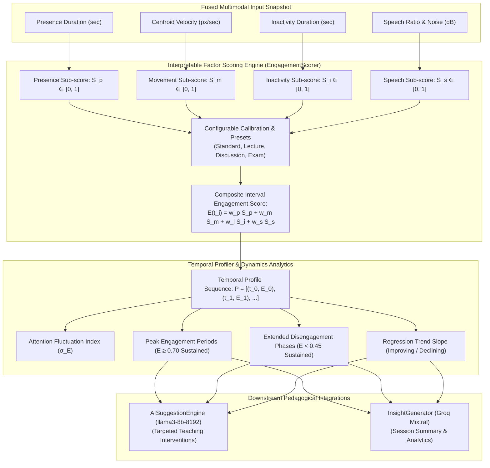

# Milestone 4 — Activity Documentation
## Interpretable Temporal Engagement Scoring & Profile Analytics

---

### 1. Executive Summary & Objective

This activity focuses on **transforming fused multimodal signals into interpretable, continuous engagement scores**. Instead of producing a static, one-time aggregated score, the scoring engine operates at regular intervals to construct a dynamic **temporal engagement profile**. This trajectory captures attention fluctuations, identifies sustained peak focus periods, and detects extended disengagement phases throughout the educational session.

The scoring architecture is designed to be **transparent, explainable, and adjustable**. It evaluates four primary behavioral factors:
1. **Sustained Visual Presence:** Cumulative participant visibility and presence duration against instructional target baselines.
2. **Movement Frequency & Velocity:** Physical displacement patterns, rewarding natural interaction while penalizing restlessness.
3. **Inactivity Duration:** Continuous periods of immobility or passive staring, decaying engagement when fatigue thresholds are crossed.
4. **Speech Activity Intensity:** Vocal interaction ratio, speech turns, and volume context.

The resulting temporal profile feeds downstream intelligence modules, providing immediate inputs for `AISuggestionEngine` (pedagogical interventions), student behavioral analytics, and session summaries.



---

### 2. Factor-Based Scoring Mathematical Formulations

At each interval $t_i$, the engine evaluates four distinct behavioral sub-scores $\in [0.0, 1.0]$:

#### 2.1 Sustained Visual Presence Sub-score ($S_p$)
Evaluates cumulative verified presence duration $\tau_p$ against the pedagogical target threshold $\tau_{\text{target}}$ (default $10.0\text{ s}$):
$$S_p = \min\left(1.0, \, \frac{\tau_p}{\tau_{\text{target}}}\right) \quad (\text{with } S_p = 0 \text{ if active participants } = 0)$$

#### 2.2 Movement Frequency & Velocity Sub-score ($S_m$)
Rewards natural physical gesturing within optimal velocity bounds $[v_{\min}, v_{\max}] = [2.5, 25.0]\text{ px/sec}$:
$$S_m = \begin{cases} 
1.0 & \text{if } v_{\min} \le \bar{v} \le v_{\max} \\
0.85 \ (\text{or } 0.60) & \text{if } \bar{v} < v_{\min} \text{ (stationary stillness)} \\
\max\left(0.10, \, 1.0 - \frac{\bar{v} - v_{\max}}{30.0}\right) & \text{if } \bar{v} > v_{\max} \text{ (restless movement)}
\end{cases}$$

#### 2.3 Inactivity Duration Sub-score ($S_i$)
Penalizes prolonged lack of movement beyond the inactivity threshold $\tau_{\text{limit}}$ (default $8.0\text{ s}$):
$$S_i = \begin{cases}
1.0 & \text{if } \tau_{\text{inactive}} \le 2.0\text{ s} \\
1.0 - 0.80 \cdot \left(\frac{\tau_{\text{inactive}} - 2.0}{\tau_{\text{limit}} - 2.0}\right) & \text{if } 2.0\text{ s} < \tau_{\text{inactive}} < \tau_{\text{limit}} \\
0.20 & \text{if } \tau_{\text{inactive}} \ge \tau_{\text{limit}}
\end{cases}$$

#### 2.4 Speech Activity Intensity Sub-score ($S_s$)
Evaluates vocal participation ratio $S_r$ against target interaction ratio $S_{\text{target}}$ (default $0.35$):
$$S_s = \min\left(1.0, \, \frac{S_r}{S_{\text{target}}}\right) \quad (\text{with a quiet attentiveness floor of } 0.50 \text{ if background noise } \le -45\text{ dBFS})$$

#### 2.5 Composite Interval Formulation
$$E(t_i) = \operatorname{clamp}\left(w_p S_p + w_m S_m + w_i S_i + w_s S_s, \, 0.0, \, 1.0\right)$$
Where $\sum w = 1.0$.

---

### 3. Temporal Profile & Dynamics Analytics

Computing engagement at sequential time steps yields a temporal trajectory $\mathcal{P} = \left[ (t_0, E_0), (t_1, E_1), \dots, (t_n, E_n) \right]$, enabling advanced behavioral analytics:

#### 3.1 Attention Fluctuation Index ($\sigma_E$)
Quantifies engagement volatility across intervals:
$$\sigma_E = \sqrt{\frac{1}{N} \sum_{i=1}^N \left(E(t_i) - \bar{E}\right)^2}$$
- Low $\sigma_E < 0.10$: Consistent, steady engagement.
- High $\sigma_E \ge 0.25$: Volatile, fluctuating attention requiring instructional stabilization.

#### 3.2 Peak Engagement Periods
Identifies contiguous time segments sustained for $\ge 2$ intervals where $E(t) \ge 0.70$. Records:
- Start interval and timestamp ($t_{\text{start}}$)
- End interval and timestamp ($t_{\text{end}}$)
- Total sustained duration ($\Delta t_{\text{peak}}$)
- Mean peak engagement score ($\bar{E}_{\text{peak}}$)

#### 3.3 Extended Disengagement Phases
Identifies contiguous time segments sustained for $\ge 2$ intervals where $E(t) < 0.45$. Automatically classifies severity:
- **`CRITICAL`** ($\bar{E} < 0.30$): Urgent pedagogical intervention required.
- **`MODERATE`** ($0.30 \le \bar{E} < 0.45$): Developing fatigue or loss of interest.

#### 3.4 Temporal Trend Slope ($m$)
Evaluates linear regression across the interval history:
$$m = \frac{\sum_{i=1}^N (i - \bar{i})(E(t_i) - \bar{E})}{\sum_{i=1}^N (i - \bar{i})^2}$$
- $m > +0.02 \implies$ **`improving`**
- $m < -0.02 \implies$ **`declining`**
- $|m| \le 0.02 \implies$ **`stable`**

---

### 4. Transparent and Adjustable Calibration

The engine provides pre-configured pedagogical presets and allows fine-tuning via REST API:

| Mode Preset | Presence Weight ($w_p$) | Movement Weight ($w_m$) | Inactivity Weight ($w_i$) | Speech Weight ($w_s$) | Intended Classroom Context |
| :--- | :---: | :---: | :---: | :---: | :--- |
| **`standard`** | $0.30$ | $0.20$ | $0.20$ | $0.30$ | General classroom instruction and activities |
| **`lecture`** | $0.45$ | $0.20$ | $0.15$ | $0.20$ | Direct lecture delivery; still, quiet listening is rewarded |
| **`discussion`**| $0.20$ | $0.25$ | $0.15$ | $0.40$ | Active debates, Q&A, and group collaborative exercises |
| **`exam`** | $0.50$ | $0.20$ | $0.10$ | $0.20$ | Formal exams; strict stillness and silence required |

Instructors and system administrators can customize weights and thresholds dynamically using `POST /engagement/configure`.

---

### 5. Downstream Integration & API Endpoints

The computed profile coordinates downstream teaching suggestions and analytics via dedicated FastAPI routes:

| Endpoint | Method | Role & Description |
| :--- | :--- | :--- |
| `/engagement/score-interval` | `POST` | Computes transparent engagement score for a single interval with factor sub-scores. |
| `/engagement/profile` | `GET` | Delivers the complete temporal sequence of interval records across the session. |
| `/engagement/analytics` | `GET` | Delivers attention fluctuation index, trend slope, peak periods, and disengagement phases. |
| `/engagement/configure` | `POST` | Allows dynamic recalibration of mode presets, component weights, and thresholds. |
| `/engagement/reset` | `POST` | Resets temporal profile memory for a new session. |
| `/ws/audio` | `WS` | Broadcasts real-time `temporal_engagement` packets containing interval scores and factor breakdowns. |

---

### 6. Automated Test Suite Results

Test suite [`backend/test_engagement_scoring_profile.py`](file:///e:/Multimodal%20Attendance%20%26%20Engagement%20Agent/MultimodalAttendance-EngagementAgent/backend/test_engagement_scoring_profile.py) executed with **100% pass rates**:

```text
======================================================================
 MULTIMODAL AGENT - TEMPORAL ENGAGEMENT SCORING & PROFILING TEST SUITE
======================================================================
Test 1: Testing factor sub-scores & composite engagement calculation...
  High Scenario -> Score: 1.0 | Sub-scores: {'presence_score': 1.0, 'movement_score': 1.0, 'inactivity_score': 1.0, 'speech_score': 1.0}
  Low Scenario -> Score: 0.31 | Level: LOW
  [PASSED] Factor sub-scores and composite formulation verified.

Test 2: Testing temporal engagement profile & attention fluctuations...
  Generated 8 intervals in temporal profile.
  Mean Score: 0.724 | Fluctuation Index (std): 0.301
  Trend: declining (slope: -0.028)
  [PASSED] Temporal profile generation and fluctuation metrics verified.

Test 3: Testing identification of peak periods & disengagement phases...
  Peak Engagement Detected: Intervals 0 to 2 (Mean: 1.0, Type: high_sustained_focus)
  Disengagement Phase Detected: Intervals 3 to 5 (Mean: 0.325, Severity: MODERATE)
  [PASSED] Peak engagement periods and disengagement phases successfully detected.

Test 4: Testing classroom presets (lecture, discussion, exam) & custom fine-tuning...
  Lecture Mode Active -> Presence Weight: 0.45 | Speech Weight: 0.2
  Lecture Stillness Score: 1.0 (HIGH)
  Discussion Mode Active -> Speech Weight: 0.4
  Custom Calibration Applied: Weights=0.4/0.2/0.2/0.2
  [PASSED] Presets and custom calibration verified.

Test 5: Testing FastAPI /engagement/* routes and WebSocket streaming...
  POST /engagement/score-interval -> Score: 0.957 | Level: HIGH
  GET /engagement/profile -> Total Intervals: 1
  GET /engagement/analytics -> Mean Score: 0.957
  POST /engagement/configure -> Mode: lecture
  WS /ws/audio Broadcast -> Temporal Score: 0.48 (MODERATE)
  [PASSED] FastAPI engagement routes and WebSocket streaming verified.

======================================================================
ALL TEMPORAL ENGAGEMENT SCORING TESTS PASSED (5/5).
======================================================================
```

---

### 7. File Reference Links

- [`backend/core/engagement_scorer.py`](file:///e:/Multimodal%20Attendance%20%26%20Engagement%20Agent/MultimodalAttendance-EngagementAgent/backend/core/engagement_scorer.py): Core temporal engagement profiler, factor scoring formulation, and dynamics analyzer.
- [`backend/core/ai_suggestions.py`](file:///e:/Multimodal%20Attendance%20%26%20Engagement%20Agent/MultimodalAttendance-EngagementAgent/backend/core/ai_suggestions.py): Downstream AI suggestion engine consuming engagement profile dynamics.
- [`backend/core/llm_insights.py`](file:///e:/Multimodal%20Attendance%20%26%20Engagement%20Agent/MultimodalAttendance-EngagementAgent/backend/core/llm_insights.py): Session summary and pedagogical insights generator.
- [`backend/app/main.py`](file:///e:/Multimodal%20Attendance%20%26%20Engagement%20Agent/MultimodalAttendance-EngagementAgent/backend/app/main.py): FastAPI endpoints (`/engagement/*`) and WebSocket streaming.
- [`backend/test_engagement_scoring_profile.py`](file:///e:/Multimodal%20Attendance%20%26%20Engagement%20Agent/MultimodalAttendance-EngagementAgent/backend/test_engagement_scoring_profile.py): Automated test suite for multi-factor scoring, fluctuations, peaks, dips, and presets.

