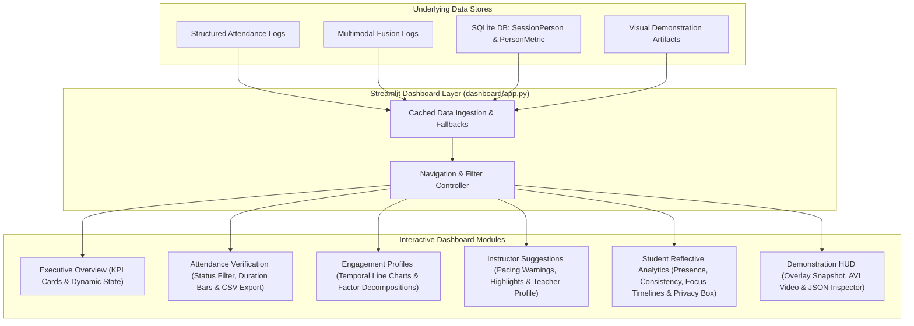

# Milestone 6: Interactive Streamlit Analytics Dashboard

## 1. Overview & Objectives

In automated educational AI systems, complex time-series signals and computer vision metadata can be overwhelming if left in raw JSON or CSV tables. The **Streamlit Analytics Dashboard** was developed as an **optional, interpretive visualization layer** to make multimodal attendance and engagement telemetry immediately interpretable, transparent, and actionable for educators and learners.

The visualization layer was intentionally architected:
- **Interpretability-First**: Improves human understanding through responsive line charts, presence histograms, metric cards, and expandable detail views.
- **Non-Mandatory**: Operates completely decoupled from core real-time processing pipelines (which run autonomously via FastAPI and background services).
- **Dual-Perspective**: Provides tailored views for both instructors (classroom-wide dynamics, pacing cues, teaching suggestions) and students (individual presence, consistency profiles, and non-evaluative self-reflection).



---

## 2. Dashboard Architecture & Views

### 2.1 View 1: Executive Overview
- **Executive Metric KPI Cards**:
  - `Enrolled Students`: Total detected participants.
  - `Verified Present`: Count and percentage of participants confirmed via cumulative presence.
  - `Mean Engagement`: Session-wide engagement index percentage with dynamic color coding (Green $\ge 70\%$, Amber $\ge 50\%$, Red $< 50\%$).
  - `Room Acoustics`: Average environmental decibel level (`dBFS`).
  - `Classroom State`: Dominant multimodal behavioral dynamic (e.g. *Attentive Listening*, *Interactive Discussion*).
- **Synchronized Trajectory Chart**: Comparative line chart tracking `Engagement Score`, `Visual Attention Index`, and `Speech Ratio` across the session.
- **Pedagogical Highlights**: Quick callout alerts summarizing peak focus intervals and pacing recommendations.

### 2.2 View 2: Attendance Records & Sustained Presence
- **Interactive Filtering**: Filter by attendance status (`ALL`, `PRESENT`, `IN_PROGRESS`, `ABSENT`) and live keyword search across participant names and student IDs.
- **Data Table**: Displays `Student ID`, `Name`, `First Detected`, `Last Detected`, `Presence (sec)`, `Frames Detected`, and `Attendance Status`.
- **Presence Duration vs. Threshold**: Horizontal bar chart comparing each student's cumulative presence seconds against the configured threshold.
- **Export Control**: One-click button to download filtered attendance logs as CSV.

### 2.3 View 3: Temporal Engagement Profiles & Dynamic Scoring
- **Time-Series Charts**: Multi-curve line plots displaying the temporal engagement score alongside acoustic decibels and speech activity.
- **Sub-score Decomposition**: Expandable table inspecting interval factor contributions:
  $$S_{\text{eng}}(t) = 0.35 \cdot S_{\text{presence}} + 0.25 \cdot S_{\text{movement}} + 0.20 \cdot S_{\text{inactivity}} + 0.20 \cdot S_{\text{speech}}$$
- **Dynamic State Classifications**: Categorizes time intervals into pedagogical states (*Attentive Listening*, *Interactive Discussion*, *Disengaged Restlessness*).

### 2.4 View 4: Instructor Suggestions & Classroom Insights
- **Real-Time Telemetry Alerts**: Non-prescriptive alerts highlighting collective attention drops or environmental noise spikes.
- **Session Teaching Suggestions**: Concrete suggestions such as inserting collaborative Think-Pair-Share checkpoints or adjusting lecture pace.
- **Teacher Effectiveness Profile**: Historical dashboard displaying instructor effectiveness score (87.5%), longitudinal trend (+12.0%), course history, and individual student progress trajectories.

### 2.5 View 5: Student-Facing Reflective Analytics
- **Individual Student Selector**: Dropdown to inspect personalized participation records.
- **Presence & Consistency Metrics**: Formatted presence time (`45m 20s`) and attention stability category (`HIGHLY_CONSISTENT`, `MODERATE_VARIATION`, `FREQUENT_SWINGS`).
- **Focus vs. Drop Timelines**: Identifies high focus intervals and brief distraction windows.
- **Constructive Metacognitive Feedback**: Encouraging tips for self-regulation (e.g. taking bullet notes during concept transitions).
- **Ethical Privacy Notice**: Prominent banner confirming that student analytics are strictly private, non-evaluative, and never used for grading penalties or peer comparisons.

### 2.6 View 6: Demonstration HUD & Media Telemetry
- **Visual HUD Snapshot**: Displays annotated demonstration frames with bounding boxes, presence badges, engagement gauges, and decibel meters (`end_to_end_pipeline_hud.jpg`).
- **Demonstration Video Player**: Provides download access to the demonstration video artifact (`classroom_session_demonstration.avi`).
- **Raw Telemetry Inspector**: Expandable JSON viewer for developer debugging.

---

## 3. How to Launch the Dashboard

The dashboard can be executed locally from the project root or backend:

```bash
# From workspace root
streamlit run dashboard/app.py

# Or using the shortcut
streamlit run dashboard_app.py
```

---

## 4. Test Suite & Verification Results

Verified via [`backend/test_dashboard.py`](file:///e:/Multimodal%20Attendance%20&%20Engagement%20Agent/MultimodalAttendance-EngagementAgent/backend/test_dashboard.py):
- **Test 1: Library Imports**: Streamlit (1.66.1), Altair (6.3.0), PyArrow (26.0.0) verified: **PASSED**.
- **Test 2: Data Loaders**: Ingestion of attendance records and temporal engagement verified: **PASSED**.
- **Test 3: Metric Integrity**: KPI aggregation (present counts, mean engagement, dominant states) verified: **PASSED**.
- **Test 4: Demonstration Artifacts**: Automatic resolution of HUD image and demonstration video verified: **PASSED**.
- **Test 5: AST Compilation**: Streamlit dashboard code AST compiled cleanly without syntax errors: **PASSED**.
- **Result**: **5/5 Tests Passed**.

